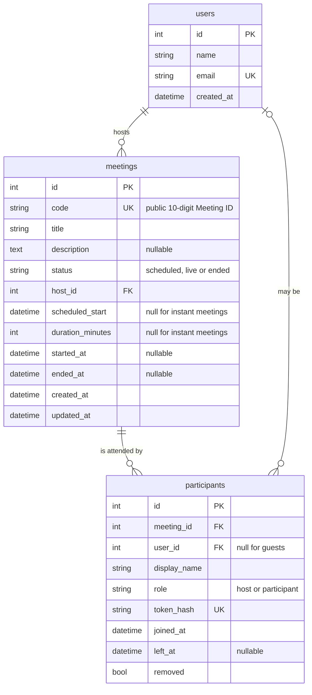
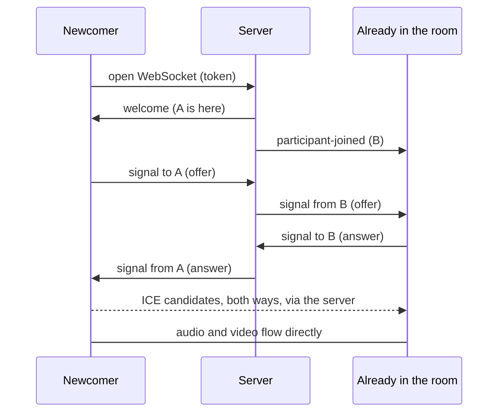

# Parley

A video meeting web app: start a meeting instantly, join one by ID or invite
link, schedule meetings for later, and run them with host controls. Video and
audio flow directly between browsers over WebRTC.

Built for the SDE Fullstack assignment with the required stack: **Next.js**
frontend, **FastAPI** backend, **SQLite** database.


## Contents

1. [What it does](#what-it-does)
2. [Tech stack](#tech-stack)
3. [Run it locally](#run-it-locally)
4. [Try it in two tabs](#try-it-in-two-tabs)
5. [Project structure](#project-structure)
6. [Database design](#database-design)
7. [How it works](#how-it-works)
8. [API reference](#api-reference)
9. [Assumptions and limits](#assumptions-and-limits)
10. [Deploying](#deploying)

## What it does

| Requirement | Where to find it |
| --- | --- |
| **Dashboard** with navbar, profile and settings placeholders | `/` shows what is next on your calendar, the three actions, and the Upcoming and Recent lists |
| **New meeting**: unique ID, invite link, redirect to the room | "New meeting" creates a live meeting with a random 10-digit ID and takes you into it as host |
| **Join** by ID or link, display name first, meeting must exist | "Join a meeting" on the dashboard, or open an invite link (`/join/<id>`). Unknown and ended meetings are refused with a clear message |
| **Schedule**: title, description, date and time, duration, link, stored, listed | "Schedule a meeting". Saved meetings appear under Upcoming, where they can be started, edited, deleted, or have their invitation copied |
| Bonus: **responsive** | Every screen works from phone width up |
| Bonus: **host controls** | In the room's People panel the host can mute everyone or remove a participant, and can end the meeting for all |

Also included: live video and audio between participants, mic and camera
toggles, a people list with everyone's mic/camera state, rejoining after a page
refresh, and meetings that end by themselves once everyone has left.

## Tech stack

| Layer | Choice |
| --- | --- |
| Frontend | Next.js 16 (App Router, client-side navigation), React 19, TypeScript, Tailwind CSS 4 |
| Backend | Python 3.12, FastAPI, SQLAlchemy 2, Pydantic 2, Uvicorn |
| Database | SQLite |
| Real time | One WebSocket per participant for presence, host controls and signalling; WebRTC for media |
| Tests | pytest (REST API and WebSocket) |

## Run it locally

You need Python 3.11 or newer and Node.js 20.9 or newer.

**1. Backend** (terminal one)

```bash
cd backend
python -m venv .venv
source .venv/bin/activate          # Windows: .venv\Scripts\activate
pip install -r requirements.txt
uvicorn app.main:app --reload
```

The API is now on http://localhost:8000 (interactive docs at `/docs`). On first
start it creates `parley.db` and fills it with sample data.

**2. Frontend** (terminal two)

```bash
cd frontend
npm install
npm run dev
```

Open http://localhost:3000.

**Tests and checks**

```bash
cd backend && pip install -r requirements-dev.txt && pytest     # 22 tests
cd frontend && npm run lint && npm run typecheck && npm run build
```

**Start over with fresh sample data**

```bash
cd backend && python -m app.seed --reset
```

Sample meeting times are set relative to the moment the database is seeded, so
reset it if the Upcoming list has gone stale.

## Try it in two tabs

1. On the dashboard choose **New meeting**. Allow the camera and microphone.
2. Choose **Invite** in the bar at the bottom to copy the link.
3. Paste the link into a second tab (or another browser), enter a name, and
   **Join meeting**. Each tab now shows the other's video.
4. In the first tab open **People**. Try **Mute everyone**, then remove the
   guest with the icon beside their name.
5. Choose **End** and then **End meeting for everyone**. The meeting moves to
   Recent on the dashboard.

Two tabs on one computer share a single camera and will echo; mute one tab or
use headphones.

## Project structure

```
backend/
  app/
    main.py              App setup: routers, CORS, startup (create tables, seed)
    config.py            Settings from environment variables
    database.py          Engine, sessions, UTC datetime column type
    models.py            The three tables
    schemas.py           Request validation and response shapes
    deps.py              "Who is the current user" (the default-user stand-in)
    errors.py            Domain errors with their HTTP status and socket close code
    services/meetings.py Every meeting rule, shared by REST and WebSocket code
    routers/meetings.py  REST endpoints
    routers/users.py
    routers/ws.py        The meeting WebSocket
    realtime/hub.py      Who is connected to which meeting (in memory)
    seed.py              Sample data
  tests/

frontend/src/
  app/                   Routes: / , /join/[code] , /meeting/[code]
  components/
    dashboard/           Dashboard screen and its sections
    meetings/            Join, schedule and delete dialogs; invite-link screen
    room/                Meeting room: tiles, control dock, people panel
    layout/  brand/  ui/ Navbar, logo and flags, reusable building blocks
  hooks/                 useDashboard, useMeetingRoom, useEnterMeeting, useNow
  lib/
    api.ts               Typed fetch wrapper for the REST API
    roomConnection.ts    WebSocket + WebRTC logic (plain TypeScript, no React)
    protocol.ts          WebSocket message types, mirrored from the backend
    session.ts           This tab's place in a meeting (sessionStorage)
    format.ts            Dates, durations, meeting IDs, invitation text
```

The same split runs through both halves: routes and components stay thin, and
the rules live in one place (`services/meetings.py` on the server,
`lib/` and `hooks/` in the browser).

## Database design



Decisions worth knowing:

- **Two identifiers per meeting.** `id` is a small internal key used by foreign
  keys. `code` is the public Meeting ID people type. Keeping them separate
  means the public format could change without touching any relationship.
- **Planned time and actual time are separate.** `scheduled_start` and
  `duration_minutes` are the plan; `started_at` and `ended_at` are what
  happened. Recent meetings show the actual length.
- **Instant or scheduled is not stored twice.** An instant meeting is simply
  one with no schedule. A CHECK constraint makes sure a meeting has both
  schedule columns or neither.
- **`participants` is an attendance record.** One row per time someone enters,
  with when they joined and left. `user_id` is nullable so people without an
  account can attend; deleting a user keeps the record (`ON DELETE SET NULL`),
  while deleting a meeting removes its attendance (`ON DELETE CASCADE`).
- **The invite link is not stored.** It is derived from `code` and the
  frontend address, so links never go stale if the site moves.
- **Only a hash of the join token is stored**, the same way passwords are
  treated. The browser holds the token itself.
- **Constraints live in the database**, not only in the app: allowed values for
  `status` and `role`, positive durations, unique `code`, `email` and
  `token_hash`.
- **Indexes match the queries**: `(host_id, status)` for the dashboard lists,
  `meeting_id` and `user_id` on participants for counts and "meetings I
  attended".
- **Times are stored in UTC** and sent with an explicit offset, so each
  browser shows them in its own timezone.
- **Participant counts come from one query.** Each meeting's count is a
  correlated subquery inside the meeting SELECT, so lists do not run a query
  per row.

## How it works

### Entering a meeting

Every route into a meeting ends the same way:

1. The browser calls the API (`/instant`, `/{code}/start` or `/{code}/join`).
   The server checks the meeting, adds a `participants` row and returns it with
   a one-time secret **token**.
2. The browser keeps `{participant id, token}` in `sessionStorage` and opens
   `/meeting/<code>`. Because it is per tab, a refresh reconnects as the same
   participant, while a new tab has to join again.
3. The room opens a WebSocket to `/ws/meetings/<code>?token=...`. The server
   hashes the token, finds the participant, and adds them to the room.

"New meeting" and "Start" make you the **host**. Joining by ID or link makes
you a **participant**.

### The meeting WebSocket

The server keeps a small in-memory map of who is connected to each meeting
(`realtime/hub.py`) and passes JSON messages around. It never touches media.

| Browser sends | Meaning |
| --- | --- |
| `media-state {audio, video}` | My mic or camera changed |
| `signal {to, data}` | Pass this WebRTC message to one participant |
| `mute-all` | Host: mute everyone else |
| `remove-participant {participantId}` | Host: remove someone |
| `end-meeting` | Host: end for everyone |

| Server sends | Meaning |
| --- | --- |
| `welcome {self, participants}` | You are in; here is who was already here |
| `participant-joined` / `-updated` / `-left` | Someone arrived, changed mic or camera, or went |
| `all-muted {by}` | The host muted everyone; switch your mic off |
| `signal {from, data}` | A WebRTC message from another participant |
| `error {message}` | A host-only action was refused |

When the server closes a socket it says why with a close code: `4401` invalid
token, `4403` removed by the host, `4404` no such meeting, `4409` opened in
another tab, `4410` meeting ended. The room turns each into a plain message.

### Video and audio (WebRTC)

Each pair of participants has a direct connection (a "mesh"). Before two
browsers can connect they must swap an offer, an answer, and their network
candidates. The WebSocket relays those. One rule keeps this simple: **whoever
joined later makes the call.**



Muting or stopping video disables the local track (silence or black frames
are sent) and tells the others through `media-state`, so they show the muted
icon or the person's flag instead of video.

### Meeting lifecycle

`scheduled` → `live` → `ended`

- An instant meeting is `live` from creation. A scheduled meeting becomes
  `live` when the first person enters.
- It becomes `ended` when the host ends it, or 15 seconds after the last
  person disconnects (the delay lets you refresh without ending your own
  meeting).
- On startup, any meeting still marked `live` is closed out, because
  connections live in memory and cannot have survived a restart.

## API reference

All REST paths are under `/api`. Errors are `{"detail": "message"}`.

| Method and path | Purpose |
| --- | --- |
| `GET /users/me` | The current (default) user |
| `GET /meetings/upcoming` | Meetings I host that are scheduled or live |
| `GET /meetings/recent` | Last 10 ended meetings I hosted or attended |
| `POST /meetings/instant` | Create a meeting and enter it as host |
| `POST /meetings/scheduled` | Schedule a meeting |
| `GET /meetings/{code}` | Look a meeting up (used to validate links) |
| `PATCH /meetings/{code}` | Edit a meeting that has not started (host) |
| `DELETE /meetings/{code}` | Delete a meeting that has not started (host) |
| `POST /meetings/{code}/start` | Enter my own meeting as host |
| `POST /meetings/{code}/join` | Enter a meeting as a participant |
| `WS /ws/meetings/{code}?token=` | The meeting socket |

Status codes: `404` no such meeting, `410` meeting has ended, `403` not the
host, `409` meeting already started, `422` invalid input.

## Assumptions and limits

- **No login.** As the brief allows, every browser acts as the seeded user
  Jamie Rivera. `app/deps.py` is the single place where real authentication
  would plug in. A consequence: who is host is decided by how you enter (New
  or Start makes you host, Join makes you a participant), and joins are
  recorded against the default user under the display name you typed.
- **Anyone with the ID can join**, and the first person in starts the meeting.
  There are no passcodes or waiting rooms.
- **Scheduled meetings stay under Upcoming until started or deleted.** One
  whose time has gone by is marked "Start time has passed".
- **Mesh video suits small groups** (about six people). Larger meetings would
  need a media server.
- **Only a public STUN server is configured by default.** People on strict
  networks (some corporate and mobile ones) may see each other in the room
  without getting audio or video; the room says so when that happens. Adding a
  TURN relay through `NEXT_PUBLIC_ICE_SERVERS` fixes it (see
  `frontend/.env.example`).
- **One API process.** Connected sockets are tracked in memory; scaling out
  would need a shared channel such as Redis pub/sub.
- **Stopping video keeps the camera open** (the track is disabled, not
  released), so the camera light can stay on.
- **Camera and microphone need a secure page**: `localhost` or HTTPS.
- **Original look.** The name, logo, colours and type are this project's own.
  Avatars are flags generated from each person's name.
- The Archivo typeface is bundled under the SIL Open Font License
  (`frontend/src/app/fonts/OFL.txt`).

## Deploying

The two halves deploy separately. Deploy the backend first so you have its
address for the frontend.

**Backend** on any host that runs a Python web service and allows WebSockets
(Render and Railway both do):

| Setting | Value |
| --- | --- |
| Root directory | `backend` |
| Build command | `pip install -r requirements.txt` |
| Start command | `uvicorn app.main:app --host 0.0.0.0 --port $PORT` |
| `PYTHON_VERSION` | `3.12.3` (the version this was tested with) |
| `FRONTEND_URL` | Your frontend's address, e.g. `https://your-app.vercel.app` |

`FRONTEND_URL` matters: invite links are built from it and it is the origin
allowed to call the API.

**Frontend** on Vercel: import the repository, set **Root Directory** to
`frontend`, and add the environment variable `NEXT_PUBLIC_API_URL` with the
backend's address (for example `https://your-api.onrender.com`, no trailing
slash). Redeploy after changing it, because it is read at build time.

After both are live, open the deployed site in two different browsers and run
through [Try it in two tabs](#try-it-in-two-tabs) once.

Things to expect on free hosting tiers:

- Idle services are often put to sleep, so the first request can take up to a
  minute.
- The disk is usually not persistent. The SQLite file is recreated and seeded
  again whenever the service restarts.
